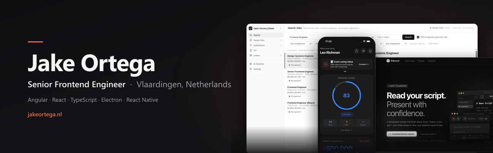
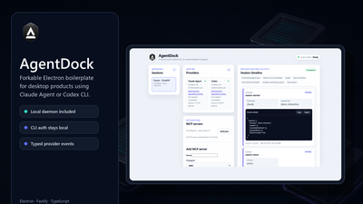
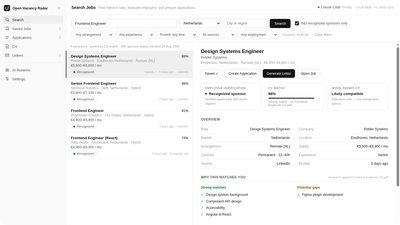
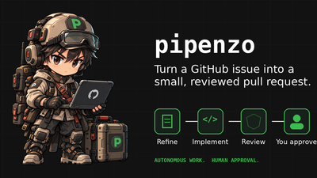
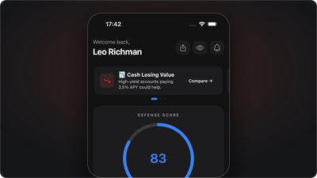
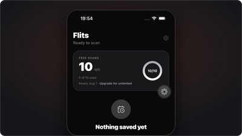
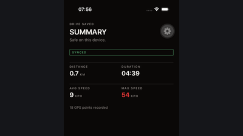
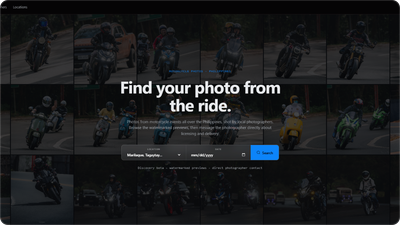
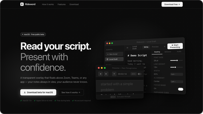

Senior Frontend Engineer | Angular, TypeScript and React

10+ years building enterprise applications and shared UI platforms with Angular, TypeScript, React, Web Components and design systems. Client work for Porsche, Ireland's National Transport Authority, Generali Vitality and Disney. Based in Vlaardingen, Netherlands.

[Portfolio](https://jakeortega.nl) · [Writing](https://jakeortega.nl/blog) · [LinkedIn](https://www.linkedin.com/in/ortegajake00/)

## Stack

## Things I've shipped

<table>
  <tr>
    <td width="240" valign="top"></td>
    <td valign="top"><b><a href="https://github.com/jortega0033/agentdock">AgentDock</a></b>: open source. Electron and local-daemon boilerplate for desktop apps that reuse a signed-in Claude Code or Codex CLI session.</td>
  </tr>
  <tr>
    <td width="240" valign="top"></td>
    <td valign="top"><b><a href="https://github.com/jortega0033/open-vacancy-radar">Open Vacancy Radar</a></b>: open source, released pre-1.0. Local-first Electron app for finding and tracking frontend vacancies.</td>
  </tr>
  <tr>
    <td width="240" valign="top"></td>
    <td valign="top"><b><a href="https://github.com/jortega0033/pipenzo">Pipenzo</a></b>: open source, work in progress. Turns a GitHub issue into a human-reviewable pull request.</td>
  </tr>
  <tr>
    <td width="240" valign="top"></td>
    <td valign="top"><b><a href="https://dutchdefend.app">Dutch Defend</a></b>: mobile app on the App Store and Google Play. Financial planning for expats in the Netherlands.</td>
  </tr>
  <tr>
    <td width="240" valign="top"></td>
    <td valign="top"><b><a href="https://getflits.app/">Flits</a></b>: mobile app on the App Store and Google Play. Turns a screenshot or photo into a calendar event.</td>
  </tr>
  <tr>
    <td width="240" valign="top"></td>
    <td valign="top"><b>Revada</b>: mobile app on the App Store and Google Play. Social driving app with GPS telemetry, shared sessions and leaderboards.</td>
  </tr>
  <tr>
    <td width="240" valign="top"></td>
    <td valign="top"><b><a href="https://grabpitik.ph">GrabPitik</a></b>: beta, payments off. Motorcycle photo marketplace for the Philippines.</td>
  </tr>
  <tr>
    <td width="240" valign="top"></td>
    <td valign="top"><b><a href="https://rideword.app">Rideword</a></b>: free beta. Desktop teleprompter overlay, formerly Presentor.</td>
  </tr>
</table>

More on [jakeortega.nl](https://jakeortega.nl).
